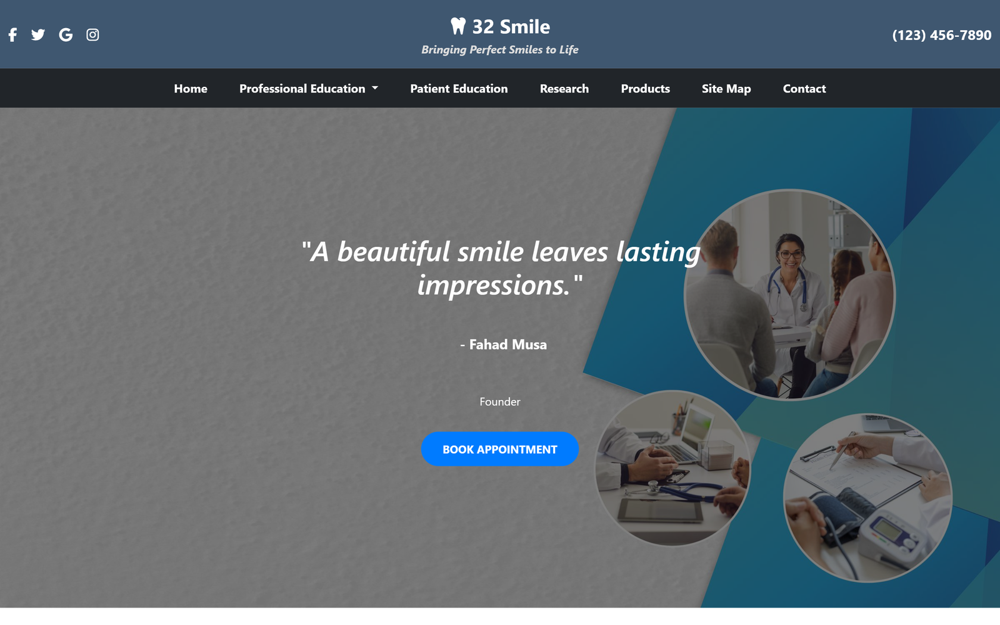
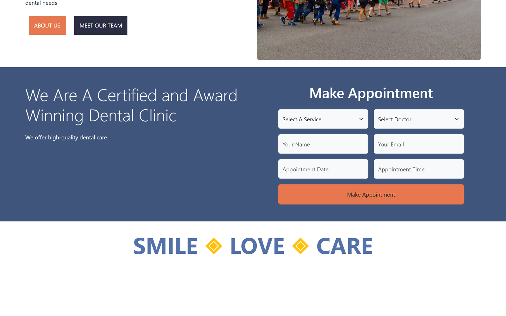
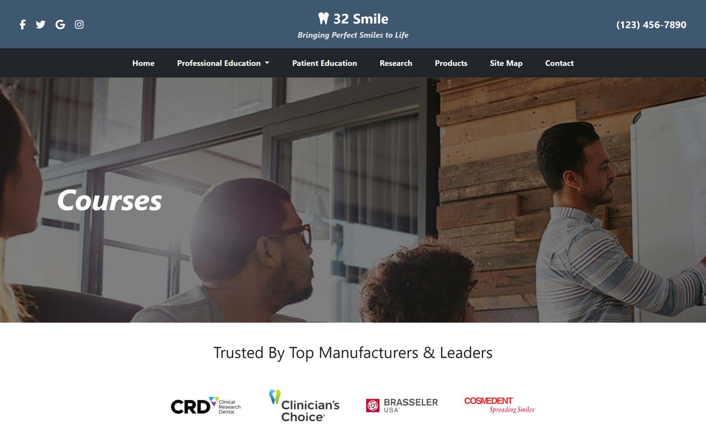
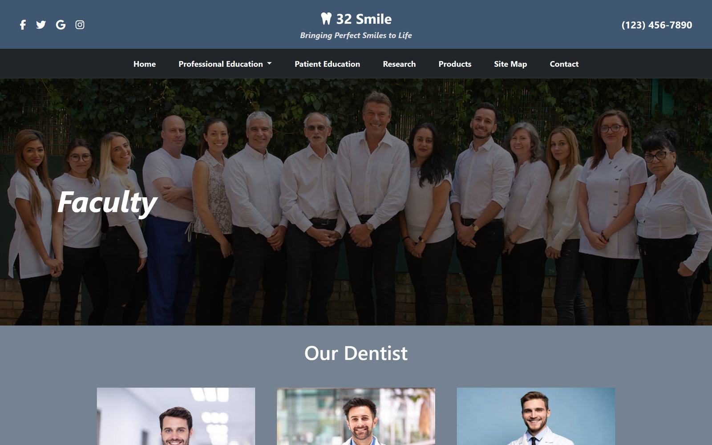
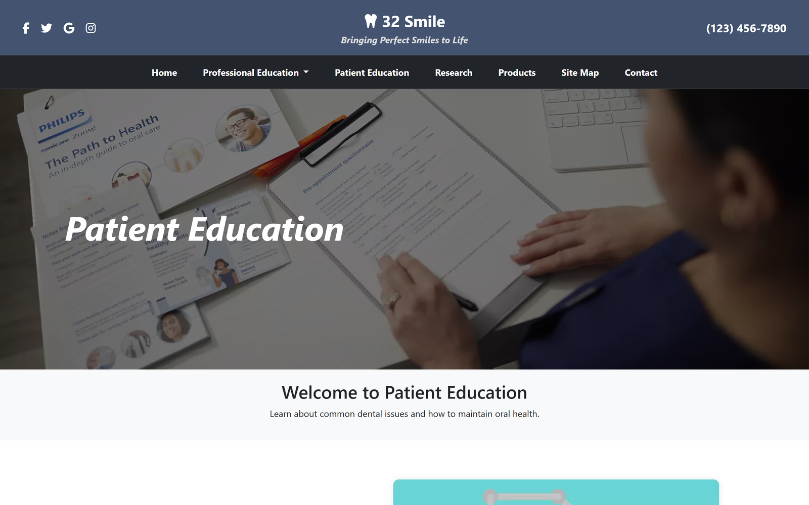
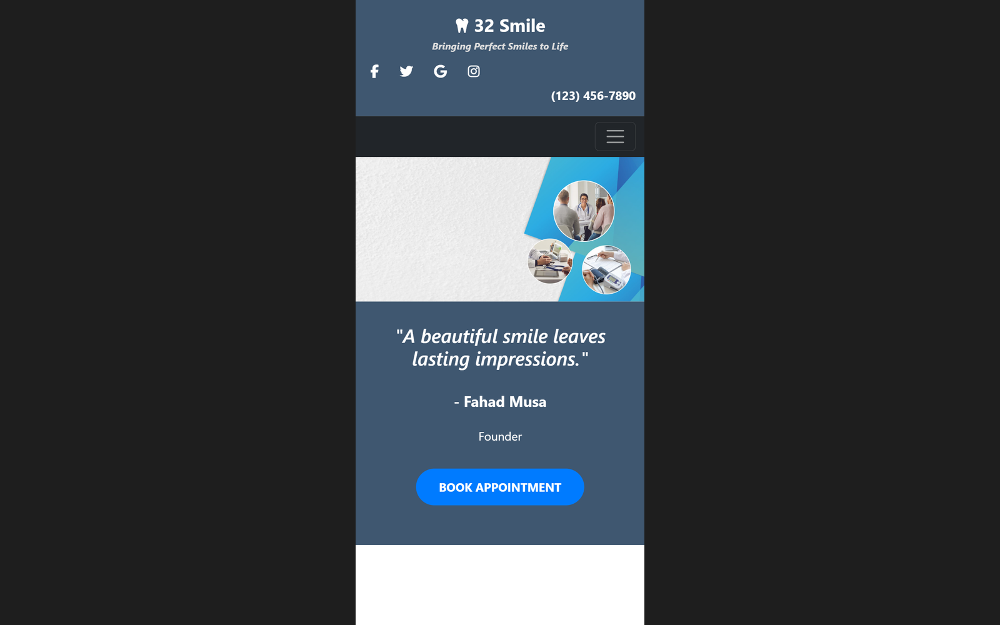

# 32 Smile

A multi-page dental clinic and education website built with HTML5, CSS3, and Bootstrap.

[](https://html.spec.whatwg.org/)
[](https://www.w3.org/Style/CSS/)
[](https://developer.mozilla.org/en-US/docs/Web/JavaScript)
[](https://getbootstrap.com/)
[](https://fontawesome.com/)
[](https://michalsnik.github.io/aos/)
[](https://vercel.com/)

## Live Demo

[https://dental-clinic-website-jade-kappa.vercel.app](https://dental-clinic-website-jade-kappa.vercel.app)

## Overview

32 Smile is a static multi-page dental clinic and dental education website comprising patient care and academic sections. It was built as a team project to provide information on clinical services, academic course listings, faculty profiles, clinical research topics, and student as well as patient reference resources.

This repository is a front-end only implementation. All appointment scheduling forms and contact submission forms are user interface mockups only; they lack form action targets, backend endpoints, and email handling integrations.

## Features

- Home page with services overview, clinic introduction, testimonials, doctor profiles, and appointment form UI (`index.html`)
- Professional Education section:
  - Courses directory with category filter buttons and instant client-side keyword search (`courses.html`)
  - Faculty directory displaying doctors, hygienists, nurses, and administrative staff profiles (`faculty.html`)
  - Case studies showcase covering orthodontic, implant, and aesthetic dentistry procedures (`casestudy.html`)
  - Help documents portal with expandable FAQ accordion sections and downloadable toolkits (`helpdoc.html`)
  - Student resources library featuring dental course syllabi and academic FAQ accordions (`student.html`)
- Patient Education portal featuring dental health topics, procedural explanations, and FAQ toggles (`patient.html`)
- Research portal featuring interactive category tabs and external Wikipedia links (`research.html`)
- Dental hygiene products catalog displaying categorized products such as toothpastes and toothbrushes (`product.html`)
- Contact Us page featuring a contact form UI and an embedded Google Maps iframe (`ContactUs.html`)
- Comprehensive site map linking to all internal pages (`Site.html`)
- Downloadable clinical PDFs and dental toolkit ZIP archives hosted in `/pdfs`
- Responsive layout across viewports built with Bootstrap grid and utility classes
- Scroll-triggered animations powered by AOS (Animate on Scroll)

## Screenshots

<table width="100%">
  <tr>
    <td align="center" valign="top" width="33.33%"><strong>Home</strong></td>
    <td align="center" valign="top" width="33.33%"><strong>Appointment Section</strong></td>
    <td align="center" valign="top" width="33.33%"><strong>Courses</strong></td>
  </tr>
  <tr>
    <td align="center" valign="top">
      
    </td>
    <td align="center" valign="top">
      
    </td>
    <td align="center" valign="top">
      
    </td>
  </tr>
  <tr>
    <td align="center" valign="top" width="33.33%"><strong>Faculty</strong></td>
    <td align="center" valign="top" width="33.33%"><strong>Patient Education</strong></td>
    <td align="center" valign="top" width="33.33%"><strong>Mobile View</strong></td>
  </tr>
  <tr>
    <td align="center" valign="top">
      
    </td>
    <td align="center" valign="top">
      
    </td>
    <td align="center" valign="top">
      
    </td>
  </tr>
</table>

The screenshots above are captured directly from the live site.

## Getting Started

Because this is a static website, you can view it directly in any modern web browser without compiling or installing backend dependencies.

### Option 1: Direct File Access
Open `index.html` directly in your web browser.

### Option 2: Local Static Server
Serve the project directory using Python:

```bash
python -m http.server 8000
```

Alternatively, use Node's `npx serve`:

```bash
npx serve .
```

Once the server is running, navigate to `http://localhost:8000` in your browser.

## Project Structure

```text
Dental-fresh/
├── docs/
│   └── screenshots/
│       ├── 01-home-hero.png
│       ├── 02-appointment-section.png
│       ├── 03-courses.png
│       ├── 04-faculty.png
│       ├── 05-patient-education.png
│       └── 06-mobile-view.png
├── img/
│   ├── main.jpg
│   └── [other site image assets]
├── pdfs/
│   ├── 2161-1122-6-359.pdf
│   ├── American_Association_of_Oral_Maxillofacial_Surgeons._Wisdom_Teeth.pdf
│   ├── behavior-change-resources.zip
│   ├── Caries_Toolkit.zip
│   ├── Gingivitis_Toolkit.zip
│   ├── Orthodontic_treatment.pdf
│   ├── Ortho_Toolkit.zip
│   ├── Periodontal_diseases-_A_brief_review.pdf
│   ├── Perio_Toolkit.zip
│   ├── Philips_Kids_Toolkit.zip
│   ├── root canal.pdf
│   └── Whitening_Toolkit.zip
├── product/
│   └── [product image assets]
├── casestudy.html
├── ContactUs.html
├── courses.html
├── faculty.html
├── helpdoc.html
├── header.css
├── home.css
├── index.html
├── patient.html
├── product.html
├── README.md
├── research.html
├── site.css
├── Site.html
└── student.html
```

## Deployment

This website is deployed on Vercel.

## Author

- **Fahad Musa**
  - LinkedIn: [https://www.linkedin.com/in/fahad-musa-ba30ab355](https://www.linkedin.com/in/fahad-musa-ba30ab355)
  - Email: [fahadmusa725@gmail.com](mailto:fahadmusa725@gmail.com)
